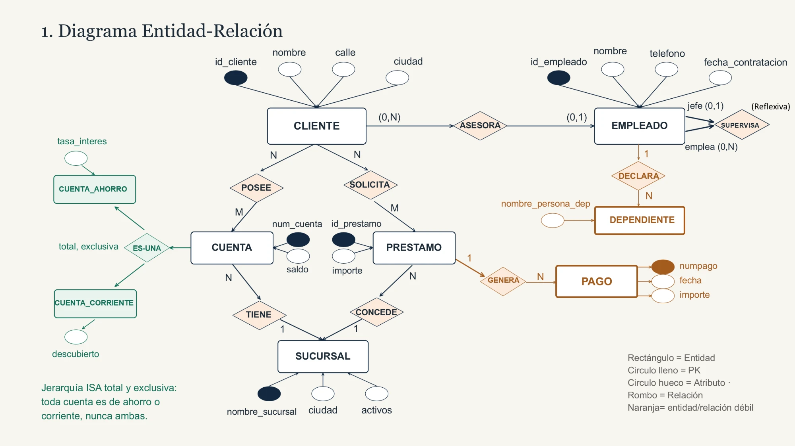
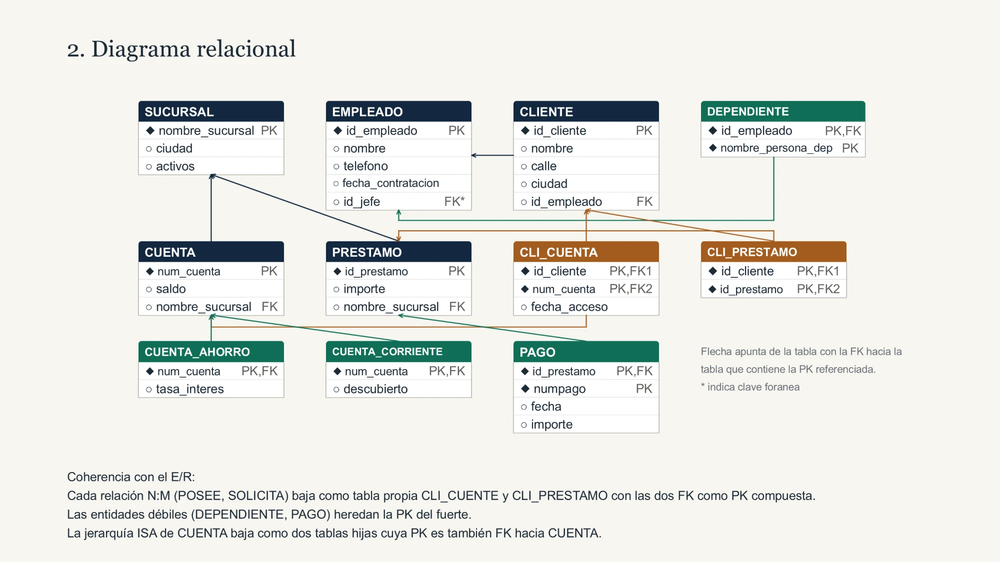
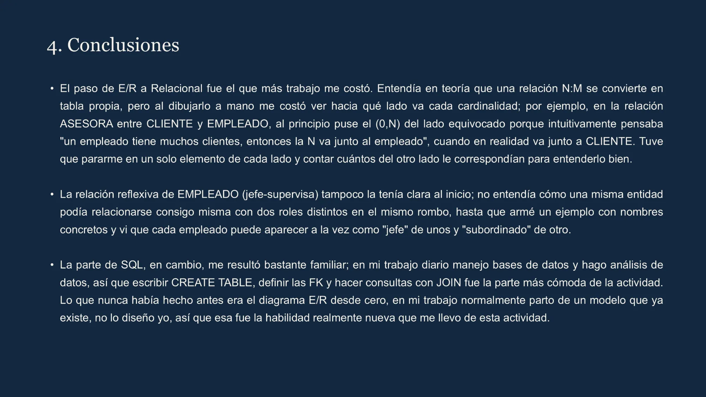

<div align="center">

# 🏦 Modelo Bancario | Diseño y Implementación en MySQL

**Del diagrama Entidad-Relación al modelo relacional y su implementación en MySQL con MySQL Workbench**

[](https://www.mysql.com/)
[](https://dev.mysql.com/downloads/workbench/)
[](#-consultas-incluidas)
[](https://git-scm.com/)
[](https://github.com/)

</div>

---

## 🎯 Descripción

Proyecto académico de la asignatura **Herramientas de Bases de Datos** (Complementos Formativos, Maestría) que modela el negocio de un **banco**: sucursales, empleados, clientes, cuentas (de ahorro y corrientes), préstamos y pagos.

El repositorio documenta el proceso completo y es **replicable por cualquier usuario**: desde el diagrama Entidad-Relación, pasando por el modelo relacional y el diagrama EER en MySQL Workbench, hasta la creación de la base de datos, la carga de datos de ejemplo y las consultas de análisis.

> 💡 Los datos del script son **ficticios**; no se utiliza información real de personas ni de entidades financieras.

---

## ✨ Características

- 🧩 **Modelado completo** - Diagrama E/R → Modelo relacional → Diagrama EER (MySQL Workbench).
- 🔗 **Integridad referencial** - Claves primarias, foráneas y compuestas definidas explícitamente.
- 🪞 **Relación reflexiva** - `EMPLEADO` se relaciona consigo mismo (jefe – subordinado).
- 🧬 **Jerarquía ISA total y exclusiva** - `CUENTA` se especializa en `CUENTA_AHORRO` o `CUENTA_CORRIENTE`.
- 🧱 **Entidades débiles** - `DEPENDIENTE` y `PAGO` heredan la PK de su entidad fuerte.
- 🔀 **Relaciones N:M** - `CLI_CUENTA` y `CLI_PRESTAMO` como tablas asociativas.
- 📊 **Consultas con JOIN** - `INNER JOIN`, `LEFT JOIN`, auto-join y agregaciones.
- 📘 **Guía paso a paso** - Instalación y ejecución desde cero.

---

## 🧭 Flujo de Trabajo

```
Requerimiento del negocio (Banco)
        ↓
📐 Diagrama Entidad-Relación (E/R)
        ↓
🧮 Modelo Relacional (reglas de transformación E/R → Relacional)
        ↓
🗺️ Diagrama EER en MySQL Workbench (.mwb)
        ↓
🛠️ Script SQL: CREATE TABLE + claves + restricciones
        ↓
📥 INSERT de datos de ejemplo
        ↓
🔍 Consultas SELECT con JOIN
```

---

## 📐 1. Diagrama Entidad-Relación



**Entidades**: `SUCURSAL`, `EMPLEADO`, `CLIENTE`, `CUENTA`, `PRESTAMO`, `DEPENDIENTE` (débil), `PAGO` (débil).

| Relación | Entidades | Cardinalidad |
|:--|:--|:--:|
| `ASESORA` | CLIENTE – EMPLEADO | (0,N) – (0,1) |
| `SUPERVISA` (reflexiva) | EMPLEADO – EMPLEADO | jefe (0,1) – emplea (0,N) |
| `DECLARA` | EMPLEADO – DEPENDIENTE | 1 – N |
| `POSEE` | CLIENTE – CUENTA | N – M |
| `SOLICITA` | CLIENTE – PRESTAMO | N – M |
| `TIENE` | CUENTA – SUCURSAL | N – 1 |
| `CONCEDE` | PRESTAMO – SUCURSAL | N – 1 |
| `GENERA` | PRESTAMO – PAGO | 1 – N |
| `ES-UNA` (ISA total y exclusiva) | CUENTA → CUENTA_AHORRO / CUENTA_CORRIENTE | toda cuenta es de uno de los dos tipos |

---

## 🧮 2. Diagrama Relacional



**Reglas de transformación aplicadas (coherencia con el E/R)**:

- Cada relación **N:M** (`POSEE`, `SOLICITA`) baja como tabla propia (`CLI_CUENTA`, `CLI_PRESTAMO`) con las dos FK como PK compuesta.
- Las **entidades débiles** (`DEPENDIENTE`, `PAGO`) heredan la PK de la entidad fuerte.
- La **jerarquía ISA** de `CUENTA` baja como dos tablas hijas cuya PK es también FK hacia `CUENTA`.
- La relación **reflexiva** se resuelve con la FK `id_jefe` dentro de `EMPLEADO`.

---

## 🗺️ 3. Diagrama EER en MySQL Workbench

El modelo físico está en [`model/EER_DIAGRAM.mwb`](model/EER_DIAGRAM.mwb). Para visualizarlo: abre MySQL Workbench → **File → Open Model…** → selecciona el archivo.

> El archivo contiene dos esquemas: `mydb` (por defecto de Workbench) y `actividad1`.

---

## 📁 Estructura del proyecto

```text
Actividad-BD-Modelo-Bancario/
│
├── docs/
│   └── Actividad1_Modelo_Bancario.pdf          # Documento de la actividad
├── images/
│   ├── 01_diagrama_entidad_relacion.webp       # Diagrama E/R
│   ├── 02_diagrama_relacional.webp             # Diagrama relacional
│   └── 03_conclusiones.webp                    # Conclusiones del autor
├── model/
│   └── EER_DIAGRAM.mwb                         # Modelo EER (MySQL Workbench)
├── sql/
│   └── ACTIVIDAD1_SOLUCION.sql                 # DDL + DML + consultas
└── README.md
```

---

## 🛠️ Tecnologías utilizadas

| Tecnología | Propósito |
|:----------:|:----------|
|  | Motor de base de datos relacional |
|  | Modelado EER, edición y ejecución de SQL |
|  | Definición, carga y consulta de datos |
|  | Control de versiones y clonación del repositorio |
|  | Hosting del repositorio |

---

## ⚙️ Requisitos previos

| Requisito | Versión recomendada | Descarga |
|:--|:--|:--|
| 🗄️ **MySQL Server** | 8.0 o 8.4 (LTS) | [dev.mysql.com/downloads/mysql](https://dev.mysql.com/downloads/mysql/) |
| 🖥️ **MySQL Workbench** | 8.0 CE o superior | [dev.mysql.com/downloads/workbench](https://dev.mysql.com/downloads/workbench/) |
| 🌱 **Git** (opcional) | 2.40 o superior | [git-scm.com/downloads](https://git-scm.com/downloads) |
| 💻 **Sistema operativo** | Windows 10/11, macOS o Linux | — |

> Alternativa: el **MySQL Installer** para Windows ([descarga](https://dev.mysql.com/downloads/installer/)) instala MySQL Server y Workbench juntos.

---

## 🚀 Guía paso a paso para replicar el proyecto

### Paso 1️⃣ — Instalar el software

**Opción A: instalación gráfica** (descarga desde los enlaces de la tabla anterior).
Durante la instalación de MySQL Server:
1. Tipo de configuración: **Development Computer**.
2. Puerto: `3306` (por defecto).
3. Define la contraseña del usuario `root` y **guárdala en un lugar seguro** (la necesitarás para conectarte).
4. Deja el servicio de Windows iniciándose automáticamente.

**Opción B: por línea de comandos en Windows (winget)**

```powershell
winget install --id Oracle.MySQL -e
winget install --id Oracle.MySQLWorkbench -e
winget install --id Git.Git -e
```

> Con esta opción, el servidor MySQL queda instalado pero debes inicializarlo y crear la contraseña de `root` según la documentación oficial de MySQL. Para principiantes se recomienda la Opción A.

### Paso 2️⃣ — Obtener el proyecto

Con Git:

```bash
git clone https://github.com/jipc3/Actividad-BD-Modelo-Bancario.git
cd Actividad-BD-Modelo-Bancario
```

Sin Git: en GitHub pulsa **Code → Download ZIP** y descomprime la carpeta.

### Paso 3️⃣ — Crear la conexión en MySQL Workbench

1. Abre **MySQL Workbench**.
2. En la pantalla de inicio pulsa el símbolo ➕ junto a **MySQL Connections**.
3. Completa los datos:

   | Campo | Valor |
   |:--|:--|
   | Connection Name | `Local - Actividad1` |
   | Hostname | `127.0.0.1` |
   | Port | `3306` |
   | Username | `root` |

4. Pulsa **Test Connection**, ingresa la contraseña cuando se solicite y confirma con **OK**.
5. Haz doble clic en la conexión para abrirla.

### Paso 4️⃣ — (Opcional) Visualizar el modelo EER

1. En Workbench: **File → Open Model…**
2. Selecciona `model/EER_DIAGRAM.mwb`.
3. Haz doble clic en **EER Diagram** para ver el diagrama con todas las tablas y relaciones.

### Paso 5️⃣ — Ejecutar el script SQL

1. Con la conexión abierta: **File → Open SQL Script…** y selecciona `sql/ACTIVIDAD1_SOLUCION.sql`.
2. Ejecuta **todo el script** con el icono del rayo ⚡ (o `Ctrl + Shift + Enter`).
3. El script realiza, en orden:
   - Crea la base de datos `ACTIVIDAD1`.
   - Crea las 11 tablas con sus claves primarias y foráneas.
   - Inserta los datos de ejemplo.
   - Ejecuta las consultas con `JOIN`.

> ⚠️ El script comienza con `CREATE DATABASE ACTIVIDAD1;`. Si lo ejecutas por segunda vez fallará porque la base ya existe. Para reiniciar, ejecuta antes: `DROP DATABASE ACTIVIDAD1;`

### Paso 6️⃣ — Verificar el resultado

Ejecuta estas consultas en una pestaña nueva:

```sql
USE ACTIVIDAD1;
SHOW TABLES;                          -- debe listar 11 tablas
SELECT COUNT(*) FROM CLIENTE;         -- debe devolver 5
SELECT COUNT(*) FROM CUENTA;          -- debe devolver 6
```

También puedes comprobarlo en el panel **Schemas** (clic derecho → **Refresh All**) y expandir `actividad1 → Tables`.

---

## 🗃️ Tablas del modelo

| Tabla | Descripción | Clave primaria |
|:--|:--|:--|
| `SUCURSAL` | Sucursales del banco | `nombre_sucursal` |
| `EMPLEADO` | Empleados (con jefe reflexivo) | `id_empleado` |
| `DEPENDIENTE` | Dependientes de un empleado (entidad débil) | `id_empleado`, `nombre_persona_dep` |
| `CLIENTE` | Clientes y su asesor | `id_cliente` |
| `CUENTA` | Cuentas bancarias (supertipo) | `num_cuenta` |
| `CUENTA_AHORRO` | Subtipo: tasa de interés | `num_cuenta` |
| `CUENTA_CORRIENTE` | Subtipo: descubierto | `num_cuenta` |
| `CLI_CUENTA` | Cliente ↔ Cuenta (N:M) con fecha de acceso | `id_cliente`, `num_cuenta` |
| `PRESTAMO` | Préstamos concedidos por sucursal | `id_prestamo` |
| `CLI_PRESTAMO` | Cliente ↔ Préstamo (N:M) | `id_cliente`, `id_prestamo` |
| `PAGO` | Pagos de un préstamo (entidad débil) | `id_prestamo`, `num_pago` |

---

## 🔍 Consultas incluidas

| # | Objetivo | Técnica |
|:-:|:--|:--|
| 1 | Clientes con su cuenta, saldo y sucursal | `INNER JOIN` (3 tablas) |
| 2 | Clientes con su asesor y el jefe del asesor | `LEFT JOIN` + auto-join |
| 3 | Préstamos con titulares y total pagado | `JOIN` + `SUM` + `GROUP BY` |

---

## 💭 Conclusiones y aprendizajes



---

## 📚 Documento completo

El informe de la actividad está en [`docs/Actividad1_Modelo_Bancario.pdf`](docs/Actividad1_Modelo_Bancario.pdf).

---

## 🧰 Solución de problemas frecuentes

| Problema | Posible causa / solución |
|:--|:--|
| `Can't connect to MySQL server on '127.0.0.1'` | El servicio MySQL no está iniciado. En Windows: `services.msc` → **MySQL80** (o `MySQL84`) → **Iniciar**. |
| `Access denied for user 'root'` | Contraseña incorrecta. Verifica la definida durante la instalación. |
| `Database 'actividad1' already exists` | Ejecuta `DROP DATABASE ACTIVIDAD1;` y vuelve a correr el script. |
| `Error Code: 1215 Cannot add foreign key` | Ejecuta el script **completo y en orden**; las tablas padre deben crearse antes que las hijas. |
| Nombres de tablas en minúscula/mayúscula | En Linux, MySQL distingue mayúsculas en nombres de tabla; usa siempre el mismo formato del script. |
| El `.mwb` no abre | Usa MySQL Workbench 8.0 o superior. |

---

## 👤 Autor

**Jeremy Palma**

Proyecto académico orientado a modelado y diseño de bases de datos relacionales.

[](https://www.linkedin.com/in/jeremy-palma-carbo/)

**Data Analyst** | **Ing. Industrial** | **MySQL** | **Modelado E/R** | **SQL**

---

<div align="center">

**Proyecto**: Herramientas de Bases de Datos - Modelo Bancario  
**Tecnología**: MySQL + MySQL Workbench  
**Última actualización**: 2026-Oct

</div>
